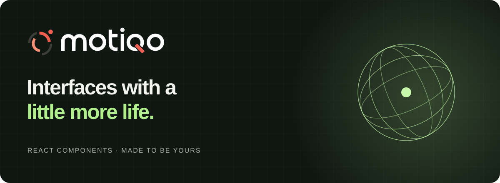
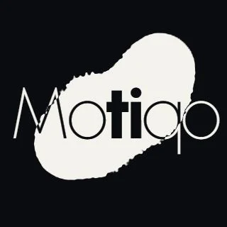
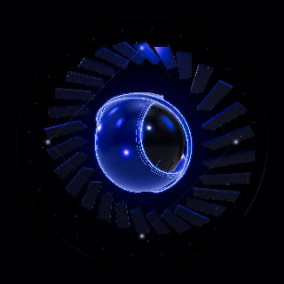
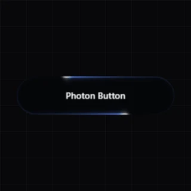
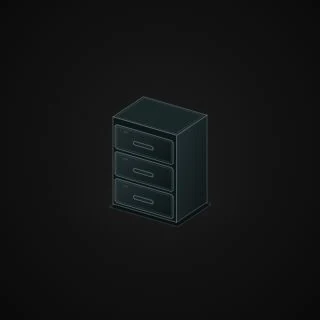

<p align="center"></p>

<p align="center">
  <a href="https://motiqo.site/">Explore Motiqo</a> &nbsp;·&nbsp;
  <a href="https://motiqo.site/library">Component library</a> &nbsp;·&nbsp;
  <a href="https://motiqo.site/docs">Documentation</a> &nbsp;·&nbsp;
  <a href="LICENSE">MIT code</a>
</p>

# Motion you can make your own.

A growing collection of <!-- count:start -->52<!-- count:end --> interactive React components: tactile buttons, generative sculptures, animated typography and small interface experiences. Explore a component, tune its controls, then bring the source into your project.

**Early stage · React + TypeScript · Source included · Built by [Robert Betancourt](https://github.com/robertbetancourt)**

## A few things to play with

Static previews below; open the library to interact with the animations.

<!-- gallery:start -->
<table>
<tr>
<td align="center" width="33%"><a href="https://motiqo.site/library?element=sacred-lotus"><br /><strong>SacredLotus</strong></a></td>
<td align="center" width="33%"><a href="https://motiqo.site/library?element=inkshift"><br /><strong>Inkshift</strong></a></td>
<td align="center" width="33%"><a href="https://motiqo.site/library?element=gyro"><br /><strong>Gyro</strong></a></td>
</tr>
<tr>
<td align="center" width="33%"><a href="https://motiqo.site/library?element=quantum-core"><br /><strong>QuantumCore</strong></a></td>
<td align="center" width="33%"><a href="https://motiqo.site/library?element=photon-button"><br /><strong>PhotonButton</strong></a></td>
<td align="center" width="33%"><a href="https://motiqo.site/library?element=helix"><br /><strong>Helix</strong></a></td>
</tr>
<tr>
<td align="center" width="33%"><a href="https://motiqo.site/library?element=aura"><br /><strong>Aura</strong></a></td>
<td align="center" width="33%"><a href="https://motiqo.site/library?element=drawer"><br /><strong>Drawer</strong></a></td>
<td align="center" width="33%"><a href="https://motiqo.site/library?element=silk-aperture"><br /><strong>Silk Aperture</strong></a></td>
</tr>
</table>
<!-- gallery:end -->

## From an idea to your interface

- **Tune it live.** Controls and moods help you find the right movement. Share a URL with your settings.
- **Own the integration.** Download a component ZIP with its helpers, local assets and a runnable example, or use the bundled CLI.
- **Keep it portable.** Exports use React and their declared dependencies, without the Motiqo site's styles or Next.js runtime.
- **Make room for stillness.** Components support pause and reduced motion; GPU components include fallbacks. Check the component's keyboard and touch behavior in your own layout.

## Use a component

### Download from the library

1. Open [the library](https://motiqo.site/library) and choose a component.
2. Adjust its settings, then download the ZIP.
3. Follow its README, install the listed dependencies and copy the component and assets into your React project.

The archive includes `Example.tsx`, your settings, `LICENSE` and resource notices. Some components need an explicitly sized container. Canvas and WebGL quality depends on the device and browser.

### Use the CLI

Download [motiqo-cli-0.1.0.tgz](https://motiqo.site/downloads/motiqo-cli-0.1.0.tgz) into your project, then:

```sh
npm install --save-dev ./motiqo-cli-0.1.0.tgz
npx motiqo list
npx motiqo add helix --dry-run
npx motiqo add helix
```

The CLI is bundled for download; it is **not published on npm**. It checks file hashes and asks you to resolve conflicting files before overwriting them. Review the dry run. `--install` optionally installs missing dependencies with lifecycle scripts disabled; otherwise it prints what to install. For AI coding tools, `npx motiqo skill` installs the included integration guide.

## Run Motiqo locally

Use Node.js 24 and npm.

```sh
git clone https://github.com/robertbetancourt/motiqo.git
cd motiqo
npm ci
npm run dev
```

Open [localhost:3014](http://127.0.0.1:3014). The development command prepares the downloadable CLI first.

```sh
npm test                 # behavioral and regression tests
npm run typecheck        # TypeScript
npm run build            # production site + downloadable CLI
npm run verify:exports   # every example in an independent React project
npm run readme:build     # refresh the gallery after changing previews
```

CI runs these checks, dependency auditing and secret scanning. Passing checks do not replace browser, accessibility or real-device performance reviews.

## Building in the open

Motiqo is still evolving. APIs and visuals may change before a stable release. Bug reports, thoughtful ideas and small fixes are welcome. If something moves you, a star helps others find the project.

[Contributing](CONTRIBUTING.md) · [Architecture](docs/architecture.md) · [Roadmap](PENDIENTES.md) · [Security policy](SECURITY.md) · [Deployment checklist](docs/security.md)

## License and resources

Original Motiqo code and documentation are **MIT licensed**, copyright 2026 Robert Betancourt. Keep the license notice when reusing the code.

Images generated with Midjourney, music created with Suno, and brand assets have separate permissions and are **excluded from the code MIT grant**. Dependencies and fonts retain their own licenses. See [LICENSE](LICENSE) and [THIRD_PARTY_NOTICES.md](THIRD_PARTY_NOTICES.md) before redistributing resources.
